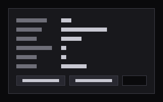

# Hello

The smallest glass extension. It exists to test the extension host. It is `dev: true`, so only development builds show it.

## What it does

- Shows the number of sessions.
- Shows one theme token (`--text-1`), the glass mode and the host context.
- Counts clicks and keeps the count in its prefs.
- Sends a `navigate` intent to open 需要你 (`#/needs`).
- Shows `suspended` and `running` when the host sends `suspend` and `resume`.
- Sends every key back to the host with `host.keys.forward`.

## c9p methods

| Method | Why |
| --- | --- |
| `session.views` | The session count |

It writes nothing through c9p.

## Host API it uses

`host.c9p.request`, `host.theme`, `host.context`, `host.prefs.get` and `host.prefs.set`, `host.intent('navigate')`, `host.on` (`theme`, `context`, `suspend`, `resume`), `host.keys.forward` and `host.ready`.

## Files

| File | Use |
| --- | --- |
| `c9ext.json` | The manifest |
| `index.js` | The page entry: `export function mount(root, host)` |
| `RECIPE.md` | This file |
| `preview.png` | The picture above |

Check it with `c9watch ext check extensions/hello`.
